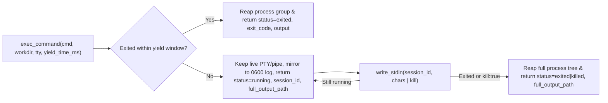

# pi-codex-exec

English | [简体中文](README.zh-CN.md)

A lightweight, single-track **unified PTY command execution** extension (`exec_command` + `write_stdin`) for the [Pi coding agent](https://pi.dev).

Instead of splitting shell work between a blocking built-in `bash` tool and a separate interactive terminal plugin, `pi-codex-exec` replaces both with two composable primitives—`exec_command` and `write_stdin`—backed by native PTYs (`zigpty`) and pipes, identical behavior across TUI / headless `pi -p` / subagents, real-time full-transcript disk mirroring, strict `setsid`-aware process-tree reaping, and an opt-in macOS Seatbelt (`sandbox-exec`) write boundary.

## Why `pi-codex-exec`?

- **Single-track model**: Short commands exit and return synchronously inside the initial `yield_time_ms` window; long-running or interactive processes (REPLs, debuggers, dev servers, SSH) seamlessly yield a `session_id` to continue with `write_stdin`. Models never have to guess between `bash` and a second interactive shell tool.
- **Native `@gotgenes/pi-permission-system` parity**: Clean `cmd` / `workdir` arguments map directly into `shellTools`, letting safe commands pass at 0 ms while dangerous commands hit full bash AST rules.
- **Unbroken real-time session logs (`full_output_path`)**: Short, non-truncated runs stay in memory with zero disk clutter. Any background session or truncated output streams every normalized byte in real time to a `0600` log file under `/private/tmp` so the model can `read(full_output_path)` without re-running commands. Stale logs older than 24 h are pruned opportunistically on startup.
- **Strict process-tree reaping**: Tracks descendants across `setsid()` / reparenting by PID + start time and tears them down cleanly (`SIGTERM` → `SIGKILL`) on exit, `kill: true`, `AbortSignal`, or `session_shutdown`.
- **Opt-in macOS Seatbelt write protection**: Flip one environment variable (`PI_CODEX_EXEC_SANDBOX=protect-sensitive`) to kernel-block writes to sensitive directories (`~/.ssh`, `~/.pi/agent/sessions`, `~/.pi/agent/auth.json`, permission configs, etc.) while keeping workspace and `/tmp` writes normal.
- **Minimal footprint**: ~800 lines of TypeScript with a single runtime dependency (`zigpty`).

## Execution Lifecycle



## Installation & Setup

### 1. Install dependencies & register in Pi

```sh
git clone https://github.com/AkiR1n/pi-codex-exec.git ~/.pi/vendor/pi-codex-exec
cd ~/.pi/vendor/pi-codex-exec
npm install
```

Add the extension and disable Pi's built-in `bash` in `~/.pi/agent/settings.json`:

```json
{
  "defaultTools": ["+codemode", "+grep", "+find", "-bash"],
  "packages": [
    "/absolute/path/to/pi-codex-exec"
  ]
}
```

### 2. Wire into `@gotgenes/pi-permission-system` (recommended)

Map `exec_command` onto the native `bash` AST gate in `~/.pi/agent/extensions/pi-permission-system/config.json`:

```json
{
  "permission": {
    "write_stdin": "ask"
  },
  "shellTools": {
    "exec_command": {
      "commandArgument": "cmd",
      "workdirArgument": "workdir"
    }
  }
}
```

Safe commands hit your existing `bash` allow rules immediately; dangerous commands (`rm -r`, `git push --force`, etc.) are intercepted with full AST parsing; `write_stdin` stays gated at tool level.

### 3. Opt-in macOS Seatbelt Write Protection (`protect-sensitive`)

Default mode is `off`. To enable kernel-level write protection for sensitive directories on macOS:

- **Via environment variable** (great for gray rollout alongside normal `pi`):
  ```sh
  PI_CODEX_EXEC_SANDBOX=protect-sensitive \
  PI_CODEX_EXEC_SANDBOX_DENY_WRITE="$HOME/my-private-data" \
  pi
  ```
- **Via optional config file** (`~/.pi/agent/extensions/pi-codex-exec.json`):
  ```json
  {
    "sandbox": "protect-sensitive",
    "denyWritePaths": ["/Users/you/path/to/protect"]
  }
  ```

When active:
- Workspace and `/tmp` reads/writes work normally; reads of protected paths still work (e.g. `ssh` reading `~/.ssh/config`).
- Direct or indirect writes (including via Python/Node scripts) to `~/.pi/agent/sessions`, `~/.pi/agent/auth.json`, `~/.pi/agent/extensions/pi-permission-system`, `~/.pi/agent/extensions/pi-permission-auto-review`, `~/.config/magpie`, `~/.ssh`, `~/.gnupg`, `~/.aws`, and any custom `denyWritePaths` are rejected by the macOS kernel (`Operation not permitted`).
- The status bar displays `SB • /pty` (or `N PTY [SB] • /pty`) so sandboxed sessions are visually distinct.

## Tool Surface & Commands

| Interface | Parameters / Usage | Notes |
| --- | --- | --- |
| `exec_command` | `cmd`, `workdir?`, `tty?` (`true`), `shell?` (`/bin/zsh`), `login?` (`false`), `yield_time_ms?` (`10000`, clamped `100..120000`), `max_output_tokens?` (`10000`) | Returns `{ status, output, wall_time_ms, truncated, exit_code? \| session_id?, full_output_path? }`. Non-zero exit codes do not throw. |
| `write_stdin` | `session_id`, `chars?` (`""`), `kill?` (`false`), `yield_time_ms?` (`5000`), `max_output_tokens?` (`10000`) | Supports `\n`, `\x03` (Ctrl+C), `\x04` (Ctrl+D). Empty `chars` polls new output. Always returns the unbroken session `full_output_path`. |
| `/pty` | `/pty`, `/pty list`, `/pty tail <id>`, `/pty kill <id\|all>` | Interactive session inspection and cleanup inside Pi TUI. |

## Testing

```sh
npm test
```

Runs 21 unit & integration tests covering native PTYs, pipes, Ctrl+C / Ctrl+D, ANSI control-sequence normalization across polls, UTF-8 / surrogate-safe truncation, multi-turn real-time session log mirroring, 24 h stale log pruning, `setsid` / reparented descendant reaping, `AbortSignal`, and real macOS `sandbox-exec` kernel write blocking.

## References & Attribution

- The two-primitive `exec_command` / `write_stdin` tool interface is inspired by the unified PTY command-execution model used in CLI coding agents such as OpenAI's Codex CLI, implemented independently from scratch for [Pi](https://pi.dev) on top of [`zigpty`](https://www.npmjs.com/package/zigpty).
- This project is an independent community extension and is not affiliated with or endorsed by OpenAI or Pi.

## License

[MIT](LICENSE)
